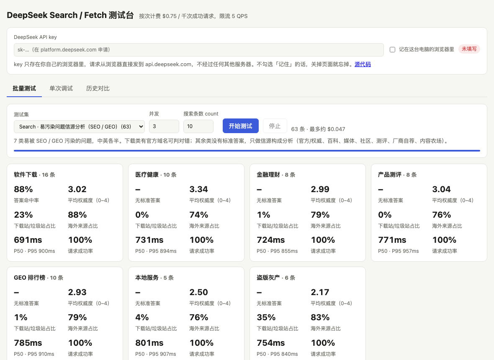
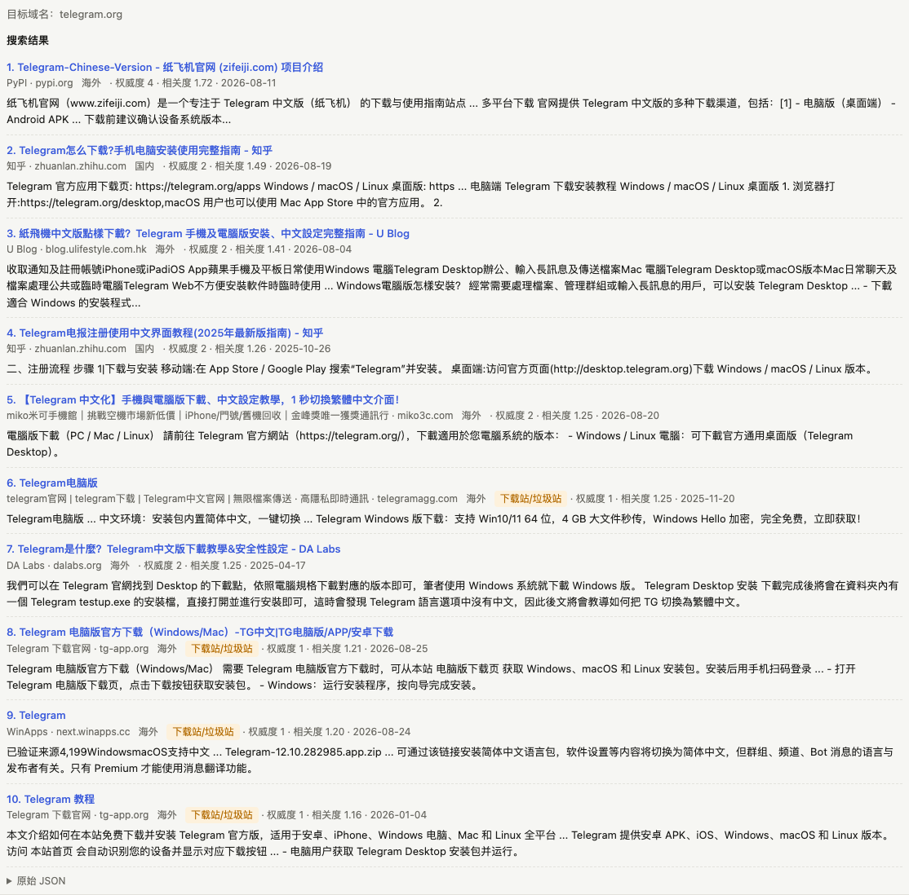
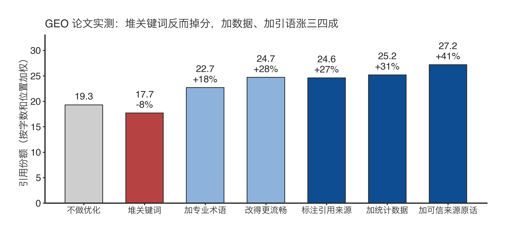
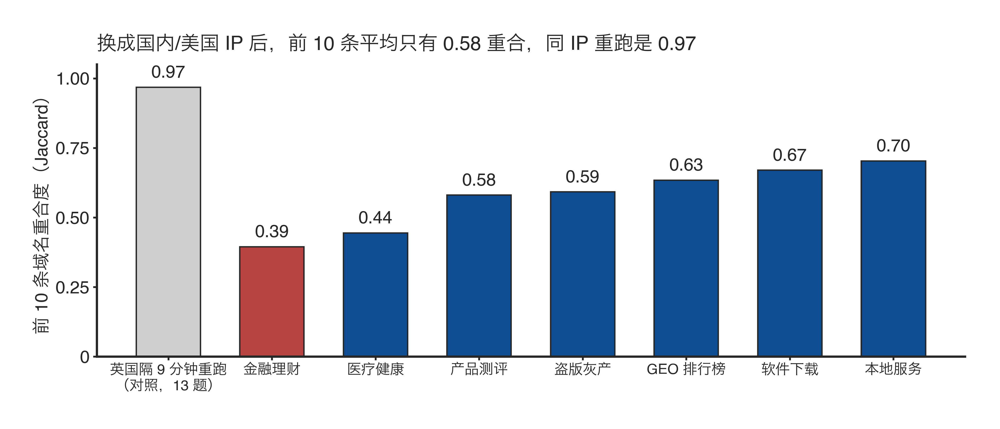

# deepseek-search-bench

测一测 [DeepSeek Search / Fetch API](https://api-docs.deepseek.com/guides/search) 的信源质量：它挡得住 SEO 垃圾站吗？挡得住 GEO 软文吗？

### 👉 [在线查看结果 / 用自己的 key 测试](https://pingfanfan.github.io/deepseek-search-bench/)

打开就能看到 2026-10-18 的全部实测数据，不用填任何东西。想自己跑，在页面顶部填上 DeepSeek API key 即可：不用安装，key 只存在你的浏览器里，请求直接发到 `api.deepseek.com`。

[](https://pingfanfan.github.io/deepseek-search-bench/)

---

## 一句话结论

**传统 SEO 基本被识破了，但 GEO 很强，靠现在这套机制很难排除。**

我用 63 个容易被污染的问题测试，中英文各半，每题取前 10 条，共 630 条结果。结果里出现的每个域名都人工归了类，再和 API 返回的 `authority`（权威度，0–4）对照。

## 主要发现

### 1. 垃圾站认得出：最高不超过 2 分

我人工标成垃圾、灰产的 21 条结果，权威度全部 ≤ 2，其中 13 条是 1 分；官方机构和学术百科平均在 3.4 上下。下载题里，英文 8 题有 7 题第一条就是原厂官网，中文 8 题只有 5 题。


### 2. 但认得出 ≠ 不返回

排序严格按相关度（`rerank_score`）走，权威度对排位影响很弱。搜「最新电影免费在线观看」，前 10 条全是盗版站，只是都标着低分。做 RAG 时，过滤要自己做。

### 3. 借壳的认不出：权威度只看站，不看页

当天的搜索结果里，有 330 个站出现过两个以上不同页面，同一个站（子域名级）下所有页面的权威度完全一样，没有一个例外。所以 PyPI 上一个给「纸飞机官网」引流的 Telegram「项目」拿了 4 分，排第一：



### 4. GEO 很强：软文照样 3 分、4 分

搜「国内 GEO 优化公司排名」，前 10 条是 9 篇发在正规科技媒体上的服务商「研究报告」「白皮书」「实力榜」，外加一个站内搜索页，权威度是 3 或 4：


这种情况不是个例。下图格子里的数字是权威度，红色是榜单类软文：


这些稿子满篇数据、模型和研究口吻，和 GEO 论文（[Aggarwal et al., KDD 2024](https://arxiv.org/abs/2311.09735)）里最能提升 AI 引用率的写法方向一致：



### 5. 换个 IP，结果换一半

结果会按调用方 IP 本地化。中文题改用国内 IP、英文题改用美国 IP 后，和不指定 IP（从英国调用）相比，前 10 条的域名重合度（Jaccard）平均只有 0.58；同一个 IP 隔 9 分钟重跑是 0.97。服务器在海外的话，记得传 `localization` 参数。



### 6. 封闭平台是盲区

微信公众号和小红书一条都搜不到，加了 `site:` 也一样；知乎能搜到，但正文抓不下来；微博、头条能搜也能抓。

---

## 使用方法

### 在线（推荐）

打开 <https://pingfanfan.github.io/deepseek-search-bench/>。页面有三个页签：

| 页签 | 用途 |
|---|---|
| 批量测试 | 选测试集后一键跑完，按分组或难度汇总；点开任意一行可看排名、权威度和摘要 |
| 单次调试 | 手动调用 Search / Fetch，支持 `site:`、`lang:`、`after:` 和 `localization` |
| 历史对比 | 你跑过的记录存在浏览器里，可以导出 JSON 发给别人，对方导入后就能看到 |

链接可以带参数，直接定位到某一题，例如 [`?run=20261018-113006-search-pollution-loc&open=43`](https://pingfanfan.github.io/deepseek-search-bench/?run=20261018-113006-search-pollution-loc&open=43)。

### 本地

```bash
python3 server.py      # 打开 http://localhost:8790，同样在网页里填 key
```

注意，直接双击 `index.html` 打不开：浏览器不允许 `file://` 页面读取 JSON 文件，必须通过 HTTP 访问。

### 命令行复现分析

只依赖 Python 3.9+ 标准库。key 从环境变量 `DEEPSEEK_API_KEY` 或 `.env` 读取。

```bash
# 1. 跑易污染问题集（63 题），中文题用国内 IP，英文题用美国 IP
python3 bench.py sets/search-pollution.json --loc zh=223.5.5.5,en=8.8.8.8
# 2. 不指定 IP 再跑一遍，对比本地化的影响
python3 bench.py sets/search-pollution.json
# 3. 信源构成分析，输出到 report/
python3 analyze.py results/<第1步>.json --compare results/<第2步>.json --set sets/search-pollution.json
```

63 题约 63 次请求，按 $0.75 / 千次计算不到 5 美分。有对照组的 key 时，可以用同一批题跑别家：`--engine tavily` 或 `--engine brave`。

## 测试集

| 文件 | 内容 |
|---|---|
| `sets/search-pollution.json` | 63 道易污染问题：软件下载、医疗、金融、测评、GEO 排行榜、本地服务、盗版灰产 |
| `sets/search-full.json` | 86 道题，难度分 L1–L4：事实、找官网、辟谣、时效、搜索语法 |
| `sets/probe-closed-platforms.json` | 先搜再抓，测公众号、小红书、知乎、抖音、X、Reddit 等平台的边界 |
| `sets/fetch-cn-vs-overseas.json` | 国内站、海外常见站、海外难抓站各 12 个 URL |

判定字段：`expect` 要求结果里出现指定关键词，`expect_domain` 要求出现指定域名，`expect_after` 要求至少有一条结果的日期晚于给定日期。同时写了多个字段的，要全部满足才算通过。

## 方法与局限

- `domains.json` 是人工标注的「域名 → 信源类别」表，按后缀匹配。分类是看完结果后由一个人标的，有主观性，欢迎提 PR。
- 「疑似软文」用启发式规则判定：结果属于媒体、测评、社区或百科类，且标题命中「研究报告、白皮书、排行榜」之类的关键词。命中后需要人工复核。
- 每种条件只跑了一次，测试日期是 2026-10-18，搜索结果会随时间变化。
- 没有接入其他搜索引擎做对照组，所以结论只能说明 DeepSeek 没挡住，不能说明别家挡住了。
- 出于版权考虑，`results/` 里 Fetch 抓回的网页正文截断到 200 字；搜索结果的标题和摘要保留原样。

## 文件结构

```
index.html     测试台页面（纯静态，浏览器直连 DeepSeek）
server.py      本地静态服务，以及命令行共用的请求函数
bench.py       命令行运行器（支持对照引擎、按语言设置 IP）
analyze.py     信源构成分析
domains.json   域名分类表
sets/          测试集
results/       运行结果
report/        分析输出
docs/          截图与图表
```

MIT License
