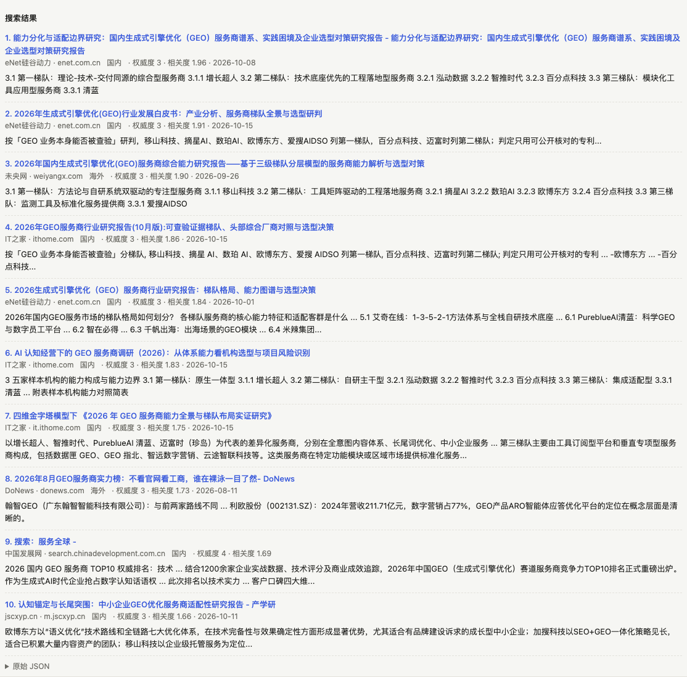
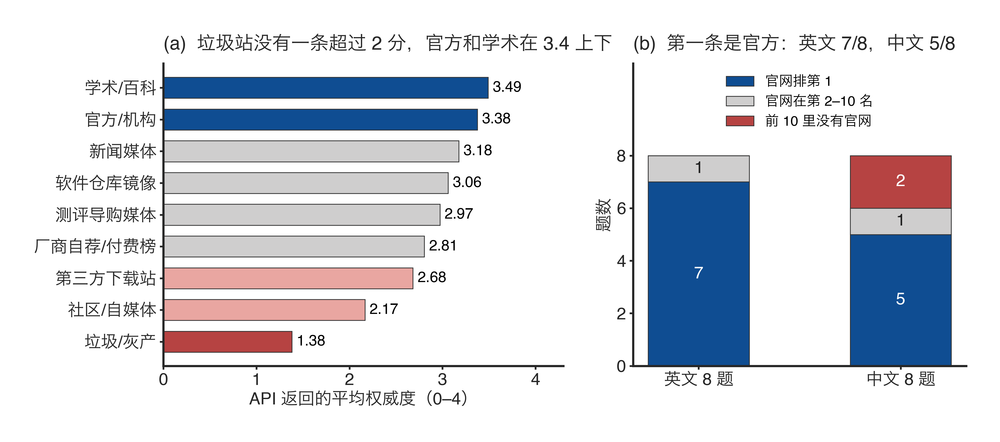
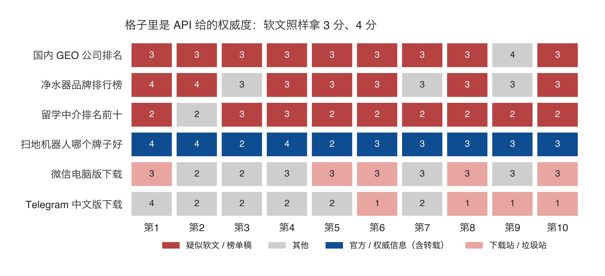

# deepseek-search-bench

**在线使用：https://pingfanfan.github.io/deepseek-search-bench/** （填自己的 API key 即可）

一个测试 [DeepSeek Search / Fetch API](https://api-docs.deepseek.com/guides/search) 的小工具。它会跑一批容易被 SEO / GEO 污染的问题，把每条结果的信源归类，再和 API 自带的 `authority`（权威度）对照，看它对垃圾站、山寨下载站和软文分别挡得怎么样。



## 直接在线用（推荐）

打开 **https://pingfanfan.github.io/deepseek-search-bench/**，在顶部填上你自己的 DeepSeek API key，就可以开始测，不用装任何东西。

- key 只存在你自己的浏览器里。请求从浏览器直接发到 `api.deepseek.com`，不经过任何其他服务器。页面是纯静态的，源码就是这个仓库里的 `index.html`。
- 勾选「记住」后，key 存在浏览器的 localStorage 里；不勾选的话，关掉页面就清空。
- 你自己跑的记录存在浏览器的 IndexedDB 里。可以导出成 JSON 发给别人，对方在「历史对比」页导入就能看。
- 仓库里自带了一批示例结果（2026-10-18 那次运行），不填 key 也能浏览。

网页有三个页签：

- **批量测试**：选测试集后一键跑完，可以按分组或按难度汇总。点开任意一行，能看到排名、权威度和摘要。
- **单次调试**：手动调用 Search 或 Fetch。Search 支持 `site:`、`lang:`、`after:` 和 `localization`。
- **历史对比**：横向对比多次运行的结果。

链接里可以带参数直接定位到某次运行的某一行，方便分享和截图，例如 `?run=<结果id>&open=43&by=level`。

## 本地打开

```bash
python3 server.py      # 打开 http://localhost:8790，同样在网页里填 key
```

注意，直接双击 `index.html` 打不开：浏览器不允许 `file://` 页面读取本地的 JSON 文件，必须通过 HTTP 访问。

## 命令行复现文章里的分析

命令行只依赖 Python 3.9+ 标准库，key 从环境变量 `DEEPSEEK_API_KEY` 或 `.env` 文件读取。

```bash
# 1. 跑易污染问题集（63 题）。中文题指定国内 IP，英文题指定美国 IP
python3 bench.py sets/search-pollution.json --loc zh=223.5.5.5,en=8.8.8.8

# 2. 不指定 IP 再跑一遍，用来对比本地化的影响
python3 bench.py sets/search-pollution.json

# 3. 信源构成分析，输出 report/report.md、stats.json、results_flat.csv
python3 analyze.py results/<第1步的结果>.json --compare results/<第2步的结果>.json --set sets/search-pollution.json
```

63 题大约 63 次请求，按 $0.75 / 千次折算不到 5 美分。如果有对照组的 key，也可以用同一批题跑别家：`--engine tavily`（需要 `TAVILY_API_KEY`）或 `--engine brave`（需要 `BRAVE_API_KEY`）。

## 测试集

| 文件 | 类型 | 内容 |
|---|---|---|
| `sets/search-pollution.json` | search | 63 道易污染问题，分 7 类：软件下载、医疗、金融、测评、GEO 排行榜、本地服务、盗版灰产，中英各半 |
| `sets/search-full.json` | search | 86 道题，难度分 L1–L4，包括事实题、找官网、辟谣、时效性、搜索语法 |
| `sets/probe-closed-platforms.json` | probe | 先搜索再抓取，测公众号、小红书、知乎、抖音、X、Reddit 等封闭平台的边界 |
| `sets/fetch-cn-vs-overseas.json` | fetch | 国内站、海外常见站、海外难抓站各 12 个 URL |

**判定字段**：
- `expect`：前 N 条结果里要出现这些关键词。
- `expect_domain`：前 N 条结果里要出现这些域名。
- `expect_after`：至少有一条结果的日期晚于这一天。

同一题写了多个字段时，要全部满足才算通过。

## 分类方法与局限

- `domains.json` 是人工标的「域名 → 信源类别」表，按后缀匹配。题目自己的 `expect_domain` 一律算「官方/机构」。分类是看完结果后由一个人标的，有主观性，欢迎提 PR 修正。
- 「疑似软文」是启发式规则：结果属于媒体、测评、社区或百科类，而且标题命中 `advertorial_title_re`（研究报告、白皮书、排行榜之类）。判定之后需要人工复核。
- API 返回的 `date` 是 UTC 的 `T16:00:00Z`，对应北京时间第二天 0 点。
- 每种条件只跑了一次，测试日期是 2026-10-18。搜索结果会随时间变化，旧数据仅供参考。
- 没有接其他搜索引擎做对照组，所以结论只能说明 DeepSeek 自身的表现。

## 2026-10-18 这次运行的主要发现

- **按站打分**：330 个出现过两个以上不同页面的站点里，同一个站（子域名级）下所有页面的 authority 完全一样，没有一个例外。
- **排序看相关度**：280 次搜索的结果全部按 `rerank_score` 降序排列。
- **垃圾站认得出，但照样返回**：人工标成垃圾/灰产的 21 条，authority 全部 ≤2，13 条是 1 分；但「免费电影」一题前 10 条全是盗版站。
- **寄生内容挡不住**：「国内 GEO 公司排名」前 10 条是 9 篇服务商「研究报告」，外加一个站内搜索页，authority 是 3 或 4。PyPI 上的 Telegram 引流页拿到 4 分。
- **IP 本地化影响很大**：换 IP 后，前 10 条结果的域名 Jaccard 平均是 0.58；同一个 IP 隔 9 分钟重跑是 0.97。
- **封闭平台**：微信公众号、小红书搜不到；知乎能搜到，但抓不到正文。




## 数据说明

`results/` 里是原始返回。出于版权考虑，公开版把 Fetch 抓回的网页正文截断到 200 字，并保留 `content_length`。搜索结果的标题和摘要保留原样。

## 文件结构

```
index.html     测试台页面（纯静态，浏览器直连 DeepSeek）
server.py      本地静态服务 + 命令行共用的请求函数
bench.py       命令行运行器（支持对照引擎、按语言设置 IP）
analyze.py     信源构成分析
domains.json   域名分类表
sets/          测试集
results/       运行结果
report/        分析输出
docs/          截图与图表
```

MIT License
